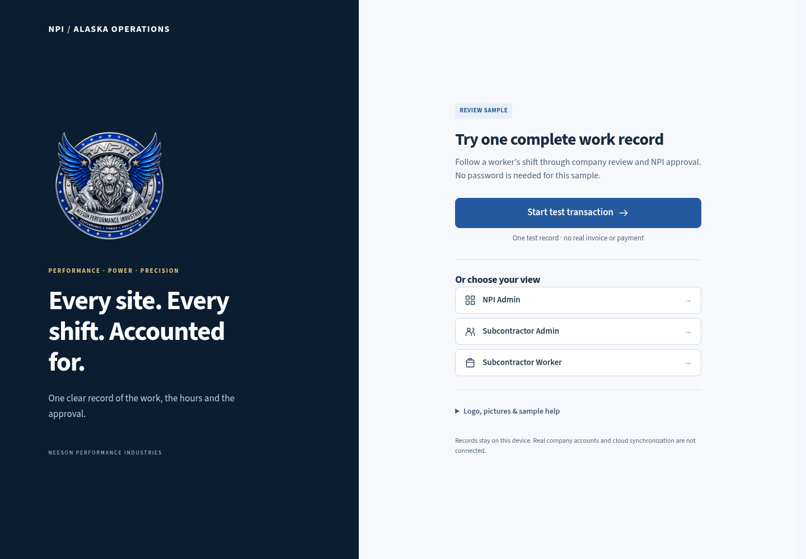
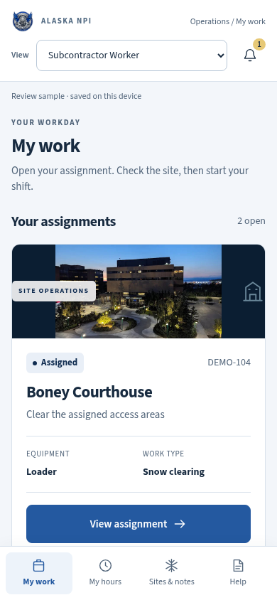
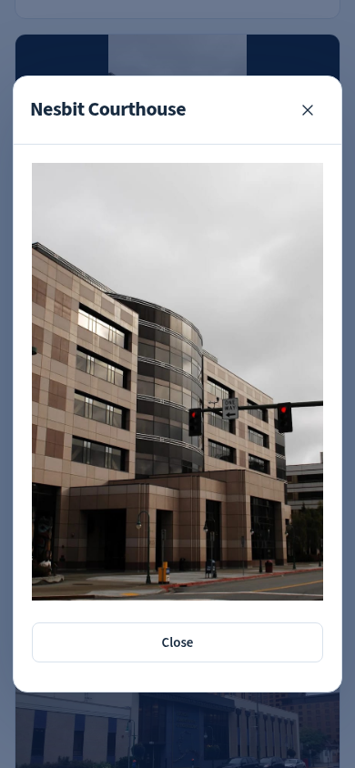
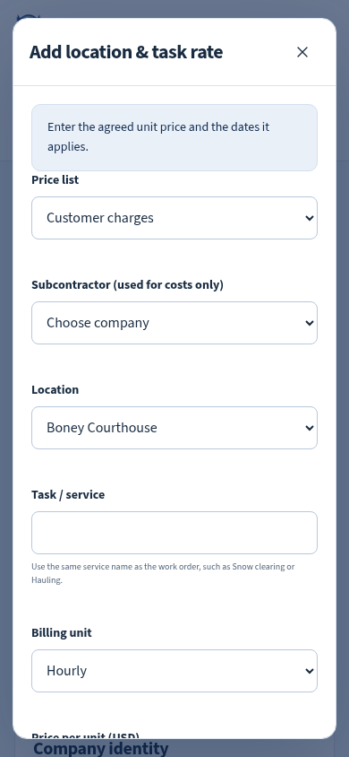
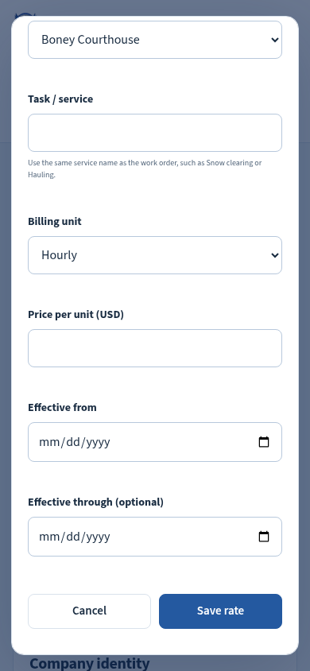
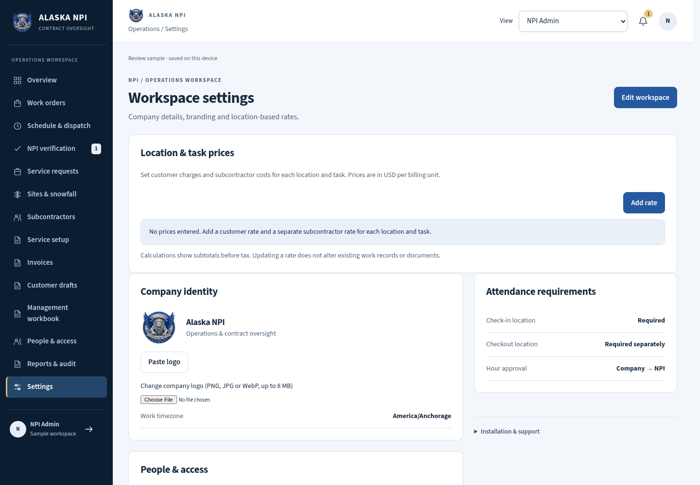

# Alaska NPI deployment audit

Verdict: UI changes verified; NOT ready for live staff, financial or shared-data use.

Method: Product Design audit plugin guidance, current screenshots captured with local Chromium/Playwright, saved-file visual inspection and axe runtime scans. This is an implementation audit, not an independent certification. No saved plugin user context was present; this conversation and the supplied files grounded the audit.

The requested logo background was removed using the image-editing tool. The transparent PNG is an edited derivative of the supplied screenshot; it is not an original vector logo or exact source-pixel extraction. Original site JPEGs remain unchanged.

## 01. Welcome and branding — UI checked

Transparent logo has no square backdrop. The branding region now has an accessible name. Three review-role entries and one primary test action are clear. Live company authentication is absent; role previews must not be used as authorization.

## 02. Worker assignment on phone — UI checked

Site identity, equipment and the View assignment action are visible above bottom navigation at 390×844. Images are site references, not work evidence. This run does not verify actual device GPS or live tenant isolation.

## 03. Site photo viewer — UI checked

The tall site photograph is contained in a named dialog with a reachable Close action. The exact viewport capture was inspected. Original site images remain unchanged. Address/site-boundary accuracy still needs management verification.

## 04. Location and task rate entry — UI checked

Separate customer/subcontractor lists and labeled billing units/dates are clear. The phone form scrolls; a second capture confirms Save rate and Cancel remain reachable. Calculations are local subtotals, not issued invoices.

## 05. Everyday settings — UI checked

Transparent logo is visible on white and navy surfaces. Operational settings precede collapsed Installation & support diagnostics. Account, storage and spreadsheet connections remain unfinished.

## 06. Custom domain and live operation — BLOCKED

alaska.npi6030.com has setup instructions only. Cloudflare/DNS access and project hostname are unavailable; no DNS or HTTPS changes were made. Managed authentication, real server/RLS authorization, evidence storage, spreadsheet synchronization and priced invoice issuance remain unconnected. There is no valid live screenshot for this step.

## Findings and limits

- Fixed: welcome branding lacked an accessible landmark name. The rerun has zero axe violations on the six captured states, no horizontal page overflow and no JavaScript errors.
- Critical: role selection is a local preview, not production authentication/authorization. No staff/customer records should be entrusted to it as a secured multi-user app.
- High: shared storage, two-way spreadsheet synchronization, private cloud evidence and priced invoice issuance remain unconnected. Supabase SQL and Apps Script files are setup foundations, not completed services.
- High: domain binding, DNS, TLS issuance and real authentication redirects were not tested. Follow the included domain guide after creating the actual Pages project.
- Limits: no full screen-reader/user test, OS/browser matrix, actual device GPS, 200% zoom matrix or production backend/DNS verification was performed. Automated scans and screenshots do not prove complete WCAG compliance.
- Repository strict static audit retains 17 pre-existing actionless-button heuristic findings on older surfaces outside the packaged frontend. It is not a repository-wide clean audit.

## Verification

104 browser checks and 32 unit tests passed. Four focused artwork checks passed. Cloudflare build passed. PNG has a genuine alpha channel with transparent corners. Domain/setup guide and screenshot report are included in the installation ZIP. DESIGN.md lint and final archive integrity results are recorded with the task's audit evidence.
